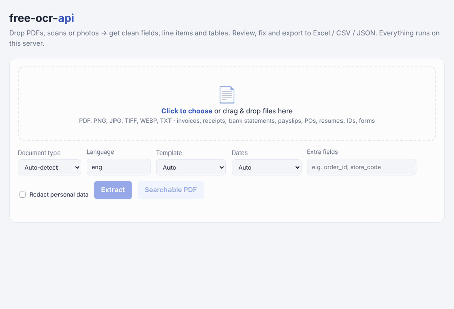
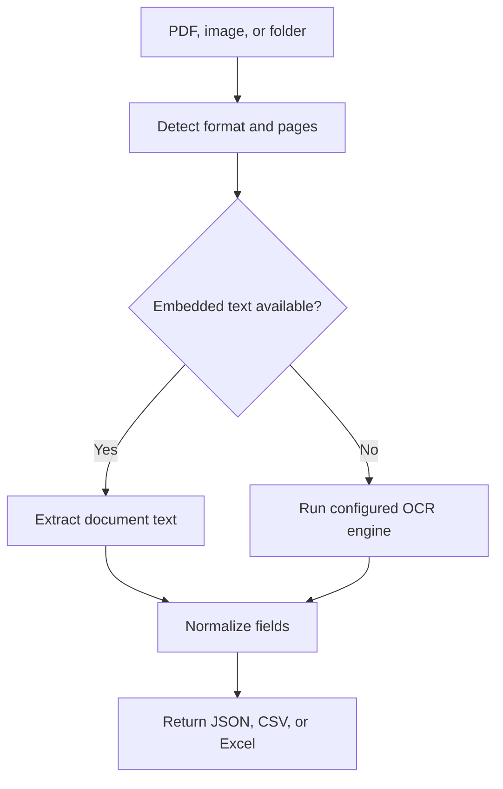

<div align="center">


# 📄 free-ocr-api

### Free, self-hosted OCR & document data extraction API

**Turn PDFs, scans and phone photos of invoices, receipts, bank statements, payslips and forms into clean JSON, CSV or Excel. No API keys, no cloud, no per-page fees.**

[](https://github.com/Ethos6/free-ocr-api/actions/workflows/ci.yml)
[](https://github.com/Ethos6/free-ocr-api/releases)
[](LICENSE)
[](pyproject.toml)
[](#-quick-start)
[](#-mcp-server)

[Quick start](#-quick-start) · [API](#-rest-api) · [Data-entry autopilot](#-data-entry-autopilot-watch-a-folder) · [Templates](#-custom-templates) · [CLI](#-cli) · [MCP](#-mcp-server)



<sub>Real extraction of the bundled sample documents (fictional companies). Re-record with <code>python scripts/record_demo.py</code>.</sub>

</div>

---

## How it works

The API accepts a document or image, detects its format and pages, extracts embedded text where available, and runs a configured OCR engine for scanned pages. It normalizes extracted fields and returns the requested JSON, CSV, or Excel output. The optional folder watcher applies the same pipeline to files as they arrive.



## Why?

Data entry means re-typing invoice numbers, totals and line items from PDFs into spreadsheets, and it eats hours every week. Paid document AI services charge **per page** and need your documents to leave your network.

**free-ocr-api** does the boring part on your own machine:

```bash
docker run -p 8000:8000 ghcr.io/ethos6/free-ocr-api   # or: docker compose up
curl -F file=@invoice.pdf localhost:8000/v1/extract
```

```json
{
  "doc_type": "invoice",
  "fields": {
    "invoice_number": "INV-2026-0042",
    "invoice_date": "2026-03-15",
    "due_date": "2026-04-14",
    "vendor_name": "Northwind Supplies Ltd",
    "customer": "Blue Harbor Cafe, 14 Mill Street, Bath BA1 1AA",
    "currency": "GBP",
    "subtotal": 288.0,
    "tax": 57.6,
    "total": 345.6,
    "vendor_tax_id": "GB123456789",
    "iban": "GB82 WEST 1234 5698 7654 32",
    "totals_check": "ok"
  },
  "line_items": [
    {"description": "Espresso beans 1kg", "quantity": 4.0, "unit_price": 18.5, "amount": 74.0},
    {"description": "Oat milk carton", "quantity": 12.0, "unit_price": 2.25, "amount": 27.0}
  ]
}
```

## ✨ Features

| | |
|---|---|
| 🔍 **OCR that just works** | Reads digital PDFs instantly from the text layer and OCRs scans and photos automatically. Supports Tesseract (100+ languages) or RapidOCR (pure `pip install`). |
| 🧾 **8 document types, auto-detected** | Invoices, receipts, bank statements, purchase orders, payslips, resumes/CVs, ID documents and generic forms |
| 📊 **Line items & tables** | Description, quantity, unit price and amount for every row. Bank statement transactions come out with debit, credit and balance. Ruled PDF tables are extracted cell by cell. |
| ✅ **Totals check** | Verifies subtotal + tax + shipping − discount = total, so bad reads get flagged |
| 🏷️ **Entities** | Emails, phones, URLs, dates (normalised to ISO), amounts, IBAN (checksum-validated), SWIFT, EU VAT, US EIN, India GSTIN/PAN/IFSC/UPI, and card numbers (masked) |
| 🧩 **Custom templates** | Describe your own fields in a 10-line YAML file, with label or regex matching, and have them applied automatically by keyword |
| 📥 **Excel / CSV / JSON / Markdown** | Batch export gives one row per document plus a *Line items* sheet. Ready for Excel, Google Sheets and accounting tools. |
| 🤖 **Data-entry autopilot** | `freeocr watch ./inbox` keeps a spreadsheet up to date as files land in a folder |
| ✏️ **Review & correct UI** | Drag-and-drop web app where you click any value to fix it, and the exports include your edits |
| 📑 **Searchable PDFs** | Turns scans and photos into PDFs with an invisible, selectable text layer, so you can search, select and copy the text. Pages that already have text are copied through untouched. |
| 🕵️ **PII redaction** | Masks emails, phones, cards, IBANs, tax IDs, SSN and Aadhaar before you store or share text |
| 🧠 **Optional model assist** | Point it at any local model server (Ollama, LM Studio, vLLM, LocalAI…) to fill custom fields the rules missed. It's off by default. |
| 🔌 **MCP server** | Lets AI assistants and editors read your local documents with `freeocr mcp` |
| 🔒 **Private by design** | Runs fully offline with no telemetry and optional API-key auth. Nothing leaves your machine. |
| 🌍 **Smart dates** | Works out whether a document writes `03/04` as day-first or month-first from its other dates and its currency |

## 🚀 Quick start

### Docker (recommended)

```bash
docker run -d -p 8000:8000 ghcr.io/ethos6/free-ocr-api:latest
```

Or build it yourself:

```bash
git clone https://github.com/Ethos6/free-ocr-api && cd free-ocr-api
docker compose up -d
open http://localhost:8000          # web UI
open http://localhost:8000/docs     # interactive API docs
```

Add OCR languages at build time: `docker build --build-arg OCR_LANGS="hin deu fra spa ara chi-sim jpn" .`

### pip

```bash
# 1) an OCR engine (only needed for scans/photos - digital PDFs work without one)
sudo apt install tesseract-ocr        # macOS: brew install tesseract  · Windows: choco install tesseract
#    ...or skip Tesseract and use the pure-Python engine:
pip install rapidocr onnxruntime

# 2) free-ocr-api
pip install "free-ocr-api @ git+https://github.com/Ethos6/free-ocr-api"
# with the pure-Python OCR engine bundled:
pip install "free-ocr-api[rapidocr] @ git+https://github.com/Ethos6/free-ocr-api"
freeocr serve                          # http://127.0.0.1:8000
```

Try it on the bundled sample documents (fictional companies):

```bash
freeocr extract examples/samples/ -o samples.xlsx
```

## 🌐 REST API

| Method | Endpoint | What it does |
|---|---|---|
| `POST` | `/v1/extract` | One document → fields, line items, tables, entities (`format=json\|csv\|xlsx\|md\|txt`) |
| `POST` | `/v1/batch` | Many documents → **one spreadsheet** (default `xlsx`) or JSON |
| `POST` | `/v1/ocr` | Plain text, page by page |
| `POST` | `/v1/searchable-pdf` | Scan or image → PDF with an invisible text layer |
| `POST` | `/v1/redact` | OCR + mask personal data |
| `POST` | `/v1/export/{fmt}` | Convert (edited) JSON results to xlsx/csv/md |
| `POST` | `/v1/templates/test` | Try a YAML/JSON template against a file before saving it |
| `GET` | `/v1/templates` | List loaded templates |
| `GET` | `/v1/info` · `/health` | Engines, doc types, formats, status |

**`/v1/extract` form fields:** `file` (required), `doc_type` (`auto`), `lang` (`eng`, `hin`, `deu`, `eng+fra`…), `template`, `fields` (extra field names), `use_llm`, `redact`, `pages` (`1-3,5`), `dayfirst` (`auto`/`true`/`false`), `force_ocr`, `include_text`, `include_pages`, `format`.

```bash
# Excel file for a whole folder of invoices
curl -F files=@jan.pdf -F files=@feb.pdf -F files=@receipt.jpg \
     localhost:8000/v1/batch -o invoices.xlsx

# CSV of the line items/fields of one document
curl -F file=@invoice.pdf -F format=csv localhost:8000/v1/extract

# Hindi + English scanned document, pages 1-2 only
curl -F file=@scan.pdf -F lang=hin+eng -F pages=1-2 localhost:8000/v1/extract
```

<details>
<summary><b>Python</b></summary>

```python
import httpx

with open("invoice.pdf", "rb") as f:
    doc = httpx.post("http://localhost:8000/v1/extract", files={"file": f}).json()

print(doc["fields"]["total"], doc["fields"]["due_date"])
for item in doc["line_items"]:
    print(item["description"], item["amount"])
```

Or skip the server and use it as a library:

```python
from freeocr import extract_document

doc = extract_document(open("receipt.jpg", "rb").read(), "receipt.jpg")
```
</details>

<details>
<summary><b>JavaScript</b></summary>

```js
const form = new FormData();
form.append("file", fileInput.files[0]);
const doc = await (await fetch("http://localhost:8000/v1/extract", { method: "POST", body: form })).json();
console.log(doc.fields, doc.line_items);
```
</details>

## 🤖 Data-entry autopilot (watch a folder)

Drop files into a folder (scanner output, email attachments, a synced Drive or Dropbox folder) and a spreadsheet updates itself:

```bash
freeocr watch ./inbox -o invoices.xlsx --done ./processed
#   + acme-0042.pdf: invoice · 16 fields
#   + IMG_2231.jpg: receipt · 12 fields
#   updated invoices.xlsx (2 rows)
```

- Each file is processed once, tracked by its SHA-256, and survives restarts.
- `--once` processes what's there and exits, which suits cron jobs.
- Output can be `.xlsx`, `.csv` or `.json`.

## 🧩 Custom templates

The built-in extractors cover common layouts. For your own forms, or for documents from one vendor, create `templates/my-form.yaml`:

```yaml
name: acme-order-form
match: ["ACME Corp"]              # auto-apply when this text appears
fields:
  order_id:      {label: ["Order #", "Order No"], type: id, required: true}
  order_date:    {label: "Order Date", type: date}
  customer_code: {regex: "CUST-(\\d{5})"}
  total:         {label: ["Grand Total", "Total"], type: amount}
  express:       {regex: "EXPRESS DELIVERY", type: bool}
```

Types: `string`, `id`, `amount`, `number`, `int`, `date`, `email`, `phone`, `percent`, `bool`. You can test a template without saving it:

```bash
curl -F file=@order.pdf -F template="$(cat templates/my-form.yaml)" localhost:8000/v1/templates/test
```

## 🧠 Optional: local model assist

The rules are fast and deterministic. For odd layouts you can ask a **local** model to fill specific fields the rules didn't find. Any server with a `/v1/chat/completions` endpoint works:

```bash
export FREEOCR_LLM_URL=http://localhost:11434/v1      # e.g. Ollama
export FREEOCR_LLM_MODEL=<any-model-you-have-pulled>
curl -F file=@contract.pdf -F fields="party_a,party_b,start_date,notice_period" -F use_llm=true \
     localhost:8000/v1/extract
```

## ⌨️ CLI

```bash
freeocr extract invoice.pdf                       # JSON to stdout
freeocr extract ./scans -r -o all.xlsx            # whole folder (recursive) → Excel
freeocr extract statement.pdf --type bank_statement -f csv
freeocr extract id.jpg --redact                   # mask personal data
freeocr ocr scan.png --lang deu                   # plain text
freeocr pdf scan.pdf -o scan-searchable.pdf       # searchable PDF (text layer)
freeocr watch ./inbox -o out.xlsx                 # autopilot
freeocr serve --host 0.0.0.0 --port 8000          # API + web UI
freeocr mcp                                       # MCP server (stdio)
freeocr info                                      # engines, types, templates
```

## 🔌 MCP server

Add this to any MCP-compatible client (desktop assistants, IDEs, agent frameworks):

```json
{
  "mcpServers": {
    "freeocr": { "command": "freeocr", "args": ["mcp"] }
  }
}
```

Tools: `extract_document`, `ocr_document`, `make_searchable_pdf`, and `extract_folder` (which saves a spreadsheet). Then ask your assistant something like *"put every invoice in ~/Downloads into invoices.xlsx"*.

## ⚙️ Configuration

| Variable | Default | |
|---|---|---|
| `FREEOCR_API_KEY` | – | Require `X-API-Key` header |
| `FREEOCR_MAX_MB` | `25` | Max upload size |
| `FREEOCR_MAX_FILES` | `100` | Max files per batch |
| `FREEOCR_ENGINE` | `auto` | `tesseract` or `rapidocr` |
| `FREEOCR_DPI` | `300` | Render resolution for scanned PDFs |
| `FREEOCR_MAX_PAGES` | `200` | Page limit per document |
| `FREEOCR_DAYFIRST` | `auto` | Force `true`/`false` date order |
| `FREEOCR_TEMPLATES` | `templates` | Template folder(s) |
| `FREEOCR_CORS` | `*` | Allowed origins |
| `FREEOCR_LLM_URL` / `_MODEL` / `_KEY` | – | Optional local model assist |
| `WORKERS` | `1` (`2` in Docker) | API worker processes |

## 🆚 Compared to paid document APIs

| | free-ocr-api | Typical cloud document AI |
|---|---|---|
| Price | **Free, MIT** | Per page / per call |
| Documents leave your network | **Never** | Yes |
| Works offline / air-gapped | **Yes** | No |
| Invoice + receipt + bank statement | ✅ | ✅ (often separate models) |
| Excel export & folder autopilot | ✅ | Build it yourself |
| Custom fields | YAML templates | Training / paid tier |
| Handwriting, very complex layouts | Limited | Better |

Be realistic: rule-based extraction works best on typed, reasonably clean documents. Check `field_confidence`, `warnings` and `totals_check` before you trust a number, and use templates or model assist for unusual layouts.

## 🛣️ Roadmap

- [ ] Utility bills, shipping labels and insurance claim extractors
- [ ] Multi-language field labels (DE/FR/ES/HI keywords)
- [ ] Webhooks and an email-inbox (IMAP) watcher
- [ ] Table-structure detection for scanned (image) tables

Ideas and PRs are welcome. See [CONTRIBUTING.md](CONTRIBUTING.md).

## Related projects

- [free-search-api](https://github.com/Ethos6/free-search-api): free self-hosted web search API
- [free-news-api](https://github.com/Ethos6/free-news-api): free news aggregation API
- [free-flight-api](https://github.com/Ethos6/free-flight-api): free live flight tracking API

---

<div align="center">

**If this saved you some typing, please ⭐ star the repo.** It helps other people find it.

MIT © Ethos6

</div>
